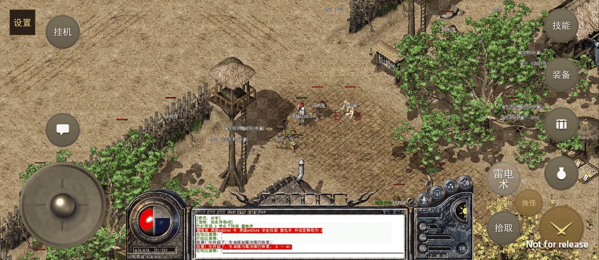

# 传奇 1.76 手机版（Mir2 Mobile）

把经典《热血传奇》1.76 搬到安卓手机上的原生重制工程 —— **Unity / Tuanjie 真源码实现**，不是模拟器套壳，也不是网页游戏。

服务端内嵌在手机里，一台手机就能开服，别的手机连过来一起打。

<p align="center">
  
  
</p>

<p align="center">
  <b><a href="https://github.com/haoxu-dev/mir2-mobile/releases/latest">⬇ 下载安装包（p2core.apk · 799 MB · 素材全打进去）</a></b><br/>
  <sub>装完就能玩，不需要编译，不需要额外下素材</sub>
</p>

<p align="center">
  <a href="https://github.com/haoxu-dev/mir2-mobile/releases/latest"></a>
  <a href="LICENSE"></a>
  
</p>

> **这个仓库只放源码，不含游戏素材，也不含预编译的核心程序集。**
> 想直接玩 → 下上面的 APK。想编译 → 先读 [「自己编译需要什么」](#自己编译需要什么)，缺的东西不止一样。

---

## 这是什么

| 项目 | 值 |
|---|---|
| 引擎 | Unity China（团结引擎）`2022.3.62t16` / 编辑器 `1.10.4` |
| 产品名 | `Mir2 P2Core` |
| 版本号 | `1.76.20261118` |
| 目标平台 | Android（arm64-v8a / x86_64） |
| 最低版本 | Android 7.0（API 24） |
| 语言 | C# |
| 代码规模 | 运行时 28 个脚本 · 23,214 行；编辑器工具 24 个 · 4,469 行 |
| 美术来源 | 官方 1.76 客户端母本（WIL / Lib 图库），逐帧还原 |

### 和原版的关系

这不是"魔改版"。数值、地图、刷怪点都对齐官方 1.76 服务端骨架：

- 服务端数据里混进来的非 1.76 内容（刺客 / 弓手相关）已剔除
- 刷怪点按 1.76 原版 `MonGen.txt` 重刷，多行重复点已合并
- 界面按官方母本逐像素比对：底栏、经验条、负重条、小地图三档
- 修复过程与逐项差异记录见 [`docs/差异清单-20261102.md`](docs/差异清单-20261102.md)

---

## 已经做到的

### 画面与界面
- **真瓦片渲染** —— 不是贴图拼的，是从 `.map` 文件读地图格、按 `Tiles.Lib` / `Objects*.Lib` 逐帧绘制
- 客户端 UI 走真源码的 `MapControl.DrawFloor()` / `DrawObjects()` / `PlayerObject.DrawBody()`，画面不是重新画的
- HUD 底栏、经验条、负重条、血条按 1024 设计宽度 + letterbox 对齐
- 小地图三档缩放
- 登录 / 选角界面重制

### 玩法闭环
- 选角 → 进游戏 → 打怪 → 得经验 → 升级 → 学技能，全链路实机跑通（选角界面是**两个预设槽位**二选一；「创建人物 / 删除人物」按钮未接账号服务器，点了会提示暂不可用）
- 技能：**目前实现了 3 个**（火球术 / 雷电术 / 治愈术），带耗蓝、冷却、伤害结算
- 死亡弹窗、城镇复活
- 怪物血条 + 本人血条
- 法术特效、远程技能"走过去再放"
- 换怪键 + 目标名条
- 聊天、装备面板、技能栏、物品栏

### 联机
**同一个 WiFi 下（局域网）**，三种连法，从简到繁：

1. **自动发现** —— 开服端每 1.5 秒广播 UDP，加入端点"搜索"三秒就能看到房间，点一下进，全程不用打字
2. **匹配码** —— 开服端屏幕显示本机 IP，加入端只输后几位（如 `1.5`），自动补全
3. **完整地址** —— `192.168.1.5:7000`，跨网段 / 端口映射用

**不同城市（公网）** 走公共 MQTT 中继（`test.mosquitto.org`），不依赖任何入站端口：

- 开服端会得到一个 **6 位匹配码**（如 `7K3QMX`），对方在「加入游戏」里输这 6 位即可
- 代价要如实说：往返延迟约 **0.3 ~ 1.7 秒**（实测中位 970ms），只适合一起走路聊天打怪，不适合讲究手速的对砍
- 为什么不用直连：实测家宽公网 IP 的入站端口 100% 超时（运营商封的），所以只能走中继

单机与开服共用同一条内嵌服务端，切换不用重连、不用重启。

---

## 这个仓库里有什么

```
Assets/
  Scripts/          运行时（28 个 .cs · 23,214 行）
    P2Core.cs               真源码渲染桥 + 主循环（2,705 行）
    P2VirtualPad.cs         虚拟摇杆与按键（3,505 行）
    P0BMapWalk.cs           地图行走与瓦片渲染（1,852 行）
    P2NetMode / P2Relay     联机模式与中继
    P2DevCmd.cs             开发者命令（1,407 行）
    P0HChat / P0HHud        聊天与 HUD
    P0HSkill / P0HItem      技能与物品
    P0HRuntime.cs           角色属性与成长
    P0IIme.cs               中文输入法（1,124 行）
    P0ACharacterSelect.cs   选角界面
    ...
  Editor/           编辑器工具（24 个 .cs · 4,469 行）
    P2Build.cs              出包入口（命令行调用，非菜单）
    P0*Import.cs            各类素材导入设置
    P0LProbe.cs             引擎能否加载核心程序集的探针
  Scenes/           13 个场景文件
  link.xml          引擎代码剥离白名单（防 GUISkin 被裁）
ProjectSettings/    工程配置
Packages/           依赖清单
docs/               差异清单与界面比对报告
screenshots/        实机截图
```

## 自己编译需要什么

**先说结论：现在直接 clone 下来是打不开、也编译不过的。** 缺三样东西，缺任何一样都跑不起来：

| 缺什么 | 为什么缺 | 怎么补 |
|---|---|---|
| `Assets/Plugins/MirClientCore.dll`（2.7 MB） | 游戏内核，由上游 [Crystal](https://github.com/Suprcode/Crystal)（GPL v2）的客户端源码编译而来。它不属于本仓库的 MIT 代码，且体积/许可都需要单独处理，所以未入库 | 需要自行从 Crystal 源码编译（`Client/` 部分编成 netstandard2.1 程序集），或联系作者 |
| `Assets/Resources/` 图集 | 由官方 `.Lib` / `.WIL` 解码而来，属版权素材，不入库 | 见下方「关于素材」 |
| `Assets/StreamingAssets/`（682 MB） | 同上，`.gitignore` 已排除 | 同上 |

另外两点要知道：

- **场景文件基本是空的**。13 个场景里 12 个是 `m_Roots: []`，唯一例外是 `Main.unity`（只有一盏灯 + 一台相机，没有任何脚本组件）；而 `ProjectSettings/EditorBuildSettings.asset` 里唯一打进包的场景 `P2.unity` 是空的。整套画面靠 `[RuntimeInitializeOnLoadMethod]` 在运行时自举，所以打开编辑器看不到东西是正常的，按 Play 才有画面。
- **场景与 `.meta` 是团结引擎私有格式**，`.unity` 里写的是 `%TAG !u! tag:yousandi.cn,2023:`，`.meta` 的 guid 是 56 字符 base64（标准 Unity 是 32 位十六进制）。用标准 Unity 2022.3 打开可能提示升级或直接不认，建议用**团结引擎 1.10.4**。

### 构建步骤（假设三样都补齐了）

1. 用团结引擎 1.10.4 打开本目录
2. 把 `MirClientCore.dll` 放到 `Assets/Plugins/`，图集放到 `Assets/Resources/`，素材按下面结构放到 `Assets/StreamingAssets/`
3. 改 `Assets/Editor/P2Build.cs` 顶部的 SDK / NDK / JDK / 工程根路径常量（现在写死的是作者的路径）
4. 命令行出包（**不是菜单，P2Build 没有 `[MenuItem]`**）：

```bash
"<团结引擎安装目录>/Editor/Tuanjie.exe" -batchmode -quit -executeMethod P2Build.SetPathsOnly
"<团结引擎安装目录>/Editor/Tuanjie.exe" -batchmode -quit -executeMethod P2Build.BuildApk
```

---

## 关于素材（重要）

**本仓库不含任何游戏素材，也不接收素材。**

`Assets/StreamingAssets/`（682 MB 的 `.Lib` / `.WIL` 图库、地图、音效）是从官方 1.76 客户端提取的版权素材。`.gitignore` 已排除，**请不要在 Issue 或 PR 里附带**。

需要本地跑起来的话，得自备一份合法持有的 1.76 客户端，把素材按原目录结构放进去：

```
Assets/StreamingAssets/Data/       Hum.Lib, Weapon.Lib, Monster/, Map/
Assets/StreamingAssets/SoundData/  SoundData.pak
Assets/StreamingAssets/ServerData/ ServerData.pak
Assets/Resources/                  图集与预烘焙资源
```

同理，`Library/`（11 GB 导入缓存）、`Builds/`（3.1 GB APK）、`Logs/` 都不入库。

**注意**：光有官方客户端的原始 `.Lib` 还不够 —— 代码里读的图集（`p0e_tiles_atlas` 等）是从 `.Lib` 解码后重新打包的 PNG，解码脚本不在本仓库里。这部分需要自己写。

---

## 安装包

APK 体积 799 MB（素材全打进去），超过 GitHub 单文件 100 MB 限制，走 **Releases** 分发：

> [Releases 页](https://github.com/haoxu-dev/mir2-mobile/releases/latest) → 下载 `p2core.apk` → 安装（需允许"未知来源"）

装完打开就能玩，不用编译。素材版权归原厂所有，仅供个人学习研究，请勿商用或二次分发。

---

## 开发进度

已完成的是"能玩、玩得像原版"；剩下的是内容填充与美术替换：

| 待做 | 状态 |
|---|---|
| 三职业可选 | 未做 —— 现在角色固定是战士，代码里没走职业选择流程 |
| 技能数量 | 3 / 33 —— 只实现了火球、雷电、治愈，其余 30 个是空位 |
| 攻城战 | 空壳 |
| 邮件系统 | 空壳 |
| 回购 | 空壳 |
| 坐骑 | 空壳 |
| 钓鱼 | 空壳 |
| 行会 | 空壳 |
| 美术素材替换 | 部分仍用重制版本 |

已知问题与逐项核实记录见 [`docs/差异清单-20261102.md`](docs/差异清单-20261102.md) 和 [`docs/差异清单-界面比对-20261102.md`](docs/差异清单-界面比对-20261102.md)。

---

## 反馈

发现问题、想提建议、想贡献代码 → 看 [CONTRIBUTING.md](CONTRIBUTING.md)，或者直接 [开个 Issue](https://github.com/haoxu-dev/mir2-mobile/issues/new)。

---

## 说明

本项目为个人学习 Unity / 游戏客户端架构的实践，**不对游戏素材主张任何权利**。《热血传奇》相关素材、名称、商标归其权利人所有。如有侵权请开 issue，会立即处理。

- **代码**（`Assets/Scripts/`、`Assets/Editor/` 等本仓库自有的部分）以 **MIT** 协议开放，见 [LICENSE](LICENSE)。
- **`MirClientCore` 内核**源自 [Suprcode/Crystal](https://github.com/Suprcode/Crystal)，其许可为 **GPL v2**，与本仓库的 MIT 部分相互独立。若要分发含该内核的产物，需遵守 GPL v2。
- **游戏素材**（`.Lib` / `.WIL` / `.map` / 音效）版权归原厂，不随本仓库分发，也不在 MIT 授权范围内。

---

<p align="center">
  <sub>如果这个项目让你省了事、或者你也想玩一个能自己开服的传奇 —— 点个 ⭐ 就是最好的支持</sub>
</p>
