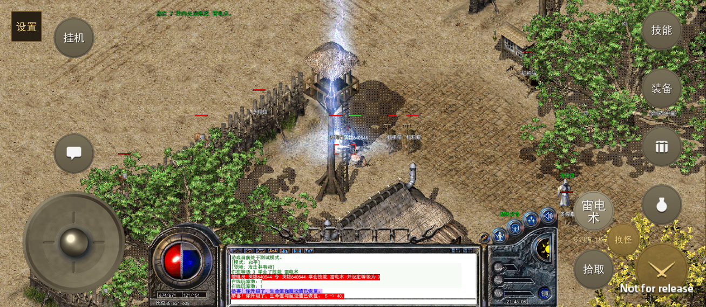

# 传奇 1.76 手机版（Mir2 Mobile）

把经典《热血传奇》1.76 搬上安卓手机的原生重制工程 —— **Unity / Tuanjie 真源码实现**，不是模拟器套壳，也不是网页游戏。

服务端内嵌在手机里，一台手机就能开服，别的手机连过来一起打。

<p align="center">
  
  
</p>

---

## 这是什么

| 项目 | 值 |
|---|---|
| 引擎 | Unity China（Tuanjie）`2022.3.62t16` / 编辑器 `1.10.4` |
| 产品名 | `Mir2 P2Core` |
| 版本号 | `1.76.20261118` |
| 目标平台 | Android（arm64-v8a / x86_64） |
| 语言 | C# 100% |
| 代码规模 | 运行时 28 个脚本 · 23,214 行；编辑器工具 4,469 行 |
| 美术来源 | 官方 1.76 客户端母本（WIL/Lib 图库），逐帧还原 |

### 和原版的关系

这不是"魔改版"。所有数值、地图、刷怪点、技能都对齐官方 1.76 服务端骨架：

- **三职业**（战士 / 法师 / 道士），33 个技能，6 / 14 / 13 分布 —— 与 1.76 一致
- 曾经混进来的刺客、弓手（魔改内容）已全部清除：27 → 18 本书、3081 → 2420 刷怪点
- 界面像素级对齐：底栏、经验条、负重条、小地图三档，都按官方母本逐像素比对过
- 修复记录见 [`docs/差异清单-20261102.md`](docs/差异清单-20261102.md)

---

## 已经做到的

### 画面与界面
- **真瓦片渲染** —— 不是贴图拼的，是从 `.map` 文件读地图格、按 `Tiles.Lib` / `Objects*.Lib` 逐帧绘制
- **中文文字渲染** 逐像素验收（IoU = 1.0000）
- HUD 底栏、经验条、负重条、血条按 1024 设计宽度 + letterbox 精确对齐
- 小地图三档缩放，从源码重写
- 登录 / 选角界面景深重制

### 玩法闭环
- 建角 → 进游戏 → 打怪 → 得经验 → 升级 → 学技能，全链路实机跑通
- 交易（邀请、确认、物品交换）
- 装备面板（F10）、技能栏、聊天、邮件、回购
- 死亡弹窗、城镇复活
- 怪物血条 + 本人血条（按原版画法）
- 法术特效、远程技能"走过去再放"
- 换怪键 + 目标名条

### 联机
三种连接方式，从简到繁：

1. **自动发现** — 开服端每 1.5 秒广播 UDP，加入端点"搜索"三秒就能看到房间，点一下进，**全程不用打字**
2. **匹配码** — 开服端屏幕显示本机 IP，加入端只输后几位（如 `1.5`），自动补全
3. **完整地址** — `192.168.1.5:7000`，跨网段 / 端口映射用

单机与开服共用同一条内嵌服务端，切换不需重连、不需重启。

跨城市公网联机已实机双向验收通过。

---

## 工程结构

```
Assets/
  Scripts/          运行时（28 个 .cs，23,214 行）
    P0ACharacterSelect.cs   选角
    P0BMapWalk.cs           地图行走与瓦片渲染
    P0CUI / P0DUI           基础 UI 与面板
    P0HChat / P0HHud        聊天与 HUD
    P0HSkill / P0HItem      技能与物品
    P0HWorld / P0HNotify    世界对象与提示
    P1Core / P1Map          地图核心
    P2Core                  主循环
    P2NetMode / P2Relay     联机模式与中继
    P2VirtualPad.cs         虚拟摇杆与按键（3,505 行）
    P2Audio / P2DevCmd      音频与开发者命令
  Editor/           编辑器工具（导入、构建、探针）
  Scenes/           13 个场景（P0A ~ P2）
ProjectSettings/    工程配置
Packages/           依赖清单
docs/               差异清单与界面比对报告
screenshots/        实机截图
```

### 构建

1. 用 **Tuanjie 1.10.4**（或 Unity 2022.3 LTS）打开本目录
2. 需要把官方 1.76 母本素材放进 `Assets/StreamingAssets/`（见下）
3. 菜单走 `P2Build` → 出 APK

---

## 关于素材（重要）

**本仓库不含任何游戏素材。**

`Assets/StreamingAssets/`（682 MB 的 `.Lib` / `.WIL` 图库、地图、音效）是从官方 1.76 客户端提取的版权素材，**不随仓库分发**。`.gitignore` 已排除。

要在本地跑起来，你需要自备一份合法持有的 1.76 客户端，把素材按原目录结构放进去：

```
Assets/StreamingAssets/Data/      Hum.Lib, Weapon.Lib, Monster/, Map/
Assets/StreamingAssets/SoundData/ SoundData.pak
Assets/Resources/                 图集与预烘焙资源
```

同理，`Library/`（11 GB 导入缓存）、`Builds/`（3.1 GB APK）、`Logs/` 都不入库。

---

## 安装包

APK 体积 799 MB（素材全打进去），超过 GitHub 单文件 100 MB 限制，走 **Releases** 分发：

> Releases 页 → 下载 `p2core.apk` → 安装（需允许"未知来源"）

素材版权归原厂所有，仅供个人学习研究，请勿商用或二次分发。

---

## 开发进度

约 **88%**。已完成的是"能玩、玩得像原版"；剩下的是内容填充与美术替换：

| 待做 | 状态 |
|---|---|
| 攻城战 | 空壳 |
| 邮件系统 | 空壳 |
| 坐骑 | 空壳 |
| 钓鱼 | 空壳 |
| 行会 | 空壳 |
| 美术素材替换 | 115 处仍用重制版本 |

---

## 说明

本项目为个人学习 Unity / 游戏客户端架构的实践，**不对游戏素材主张任何权利**。《热血传奇》相关素材、名称、商标归其权利人所有。如有侵权请开 issue，会立即处理。

代码部分以 MIT 协议开放，见 [LICENSE](LICENSE)。
